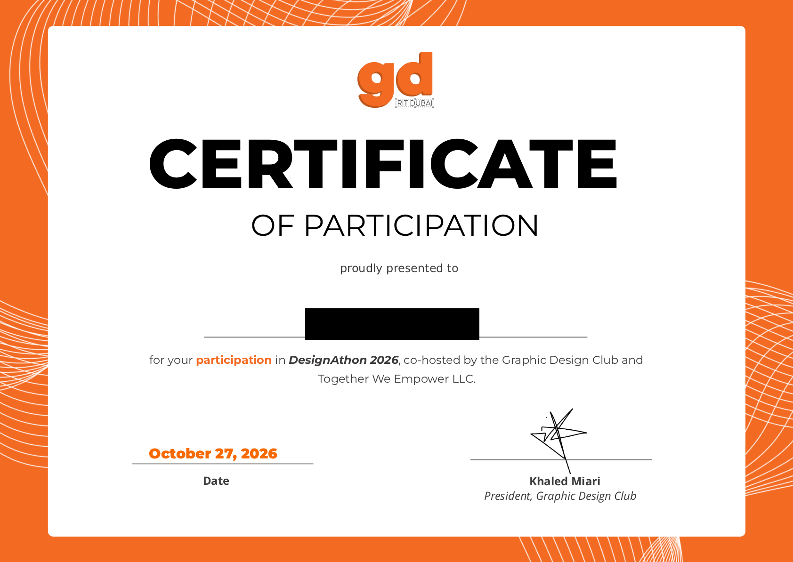

# rit-designathon
## The DesignAthon Experience
This project was built during the RIT DesignAthon. The goal of the event was to design and prototype a solution under a 10 day deadline. 
* **My Role:** solo creator (UI/UX Designer / Front-end Developer)
* **The Problem:** build an online solution for problems that university students face
* **The Solution:** A centralized, independent platform built specifically for university students. It gathers all essential study-abroad information into a single, comprehensive space. Because the platform is entirely un-sponsored, it offers honest insights so students can make confident, informed decisions without jumping between endless tabs.

### Verification of Participation

## 🛠️ Built With & AI Workflow
*HTML5, CSS3, Javascript
Built using AI assistance
* **AI Tools Leveraged:** [Claude,google AI studio]
 